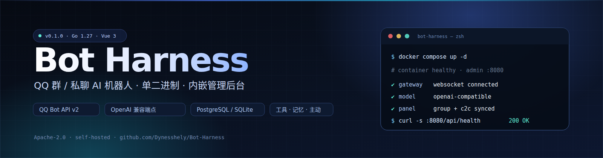
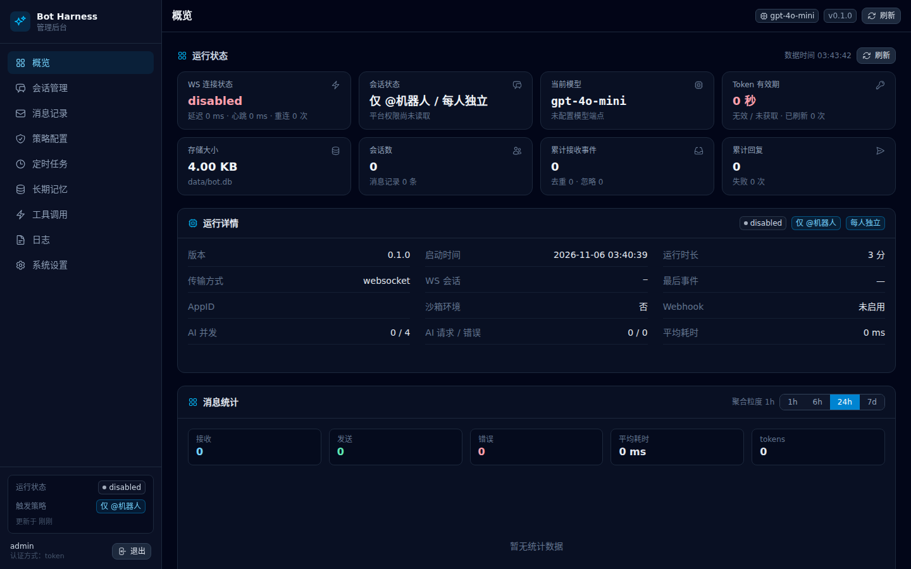
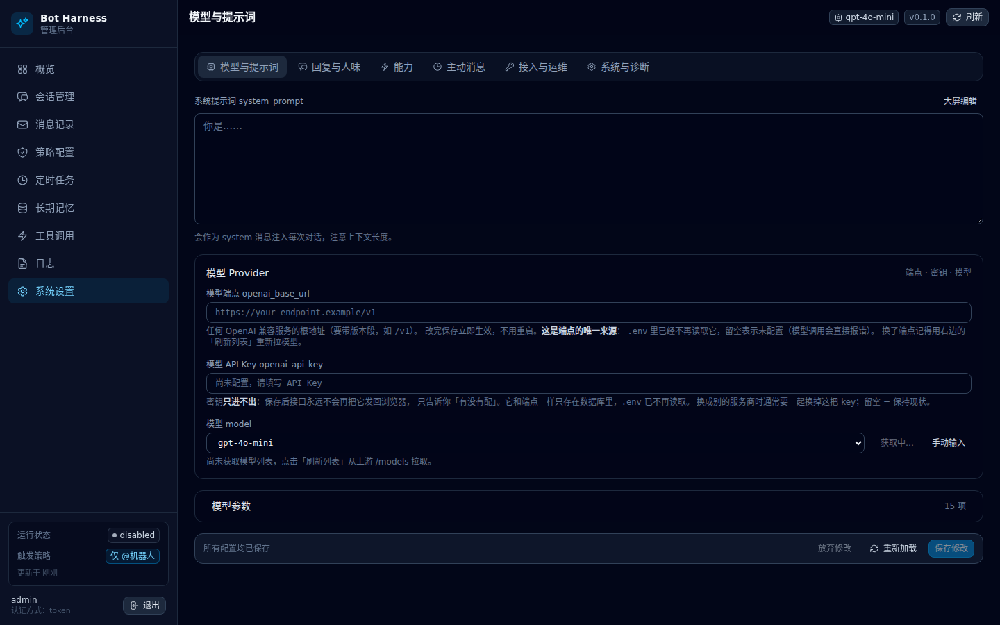
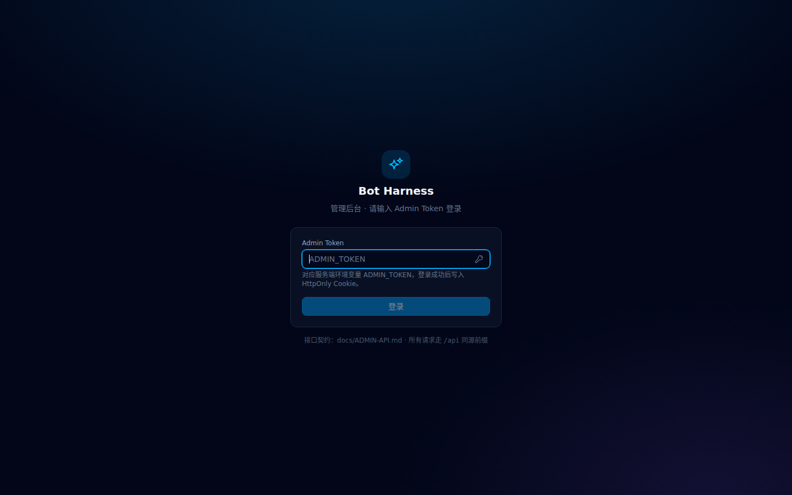
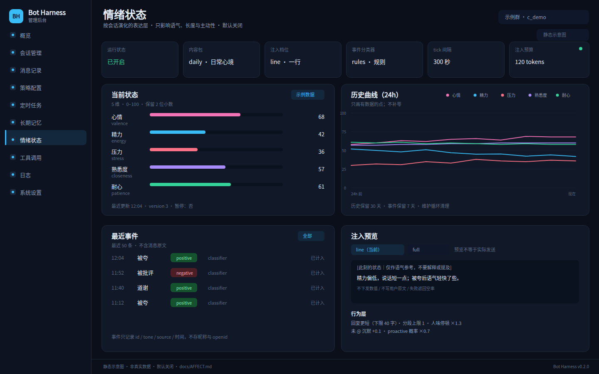
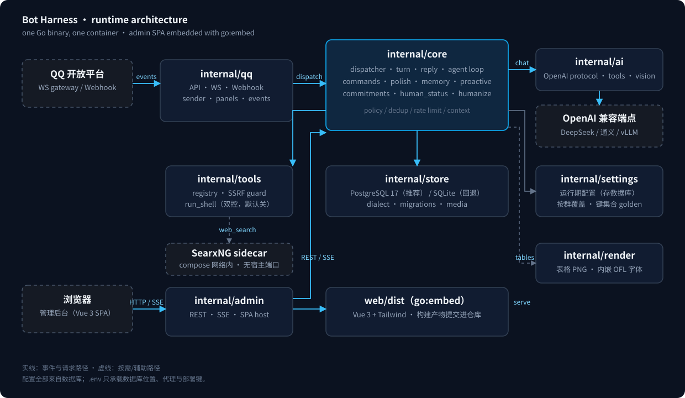

<p align="center">
  <a href="https://github.com/Dynesshely/Bot-Harness/actions/workflows/ci.yml"></a>
  <a href="LICENSE"></a>
  <a href="go.mod"></a>
  
</p>

<h1 align="center">Bot Harness</h1>

<p align="center">
  <b>把 LLM 接进 QQ 群聊的运行时底座</b><br>
  不只会回答问题，还会判断该不该接话、怎么接、用什么口吻接。
</p>

<p align="center">
  <a href="#快速开始">快速开始</a> ·
  <a href="#核心能力">核心能力</a> ·
  <a href="#架构">架构</a> ·
  <a href="#管理后台">管理后台</a> ·
  <a href="#开发与测试">开发</a> ·
  <a href="docs/ADMIN-API.md">API</a> ·
  <a href="docs/DECISIONS.md">设计决策</a>
</p>

---

## 为什么是 Bot Harness

大多数 QQ 机器人把「收到消息 → 调模型 → 发出去」当成全部。Bot Harness 把中间那段做厚了：

| 现实问题 | Bot Harness 的做法 |
|---|---|
| 群里没 @ 它，但它想接话 | **自主加入**：一次模型调用判断 `join / wait / skip`、`addressed_to` 与话题状态，硬闸门兜底 |
| 一句想法拆成三条发，它抢答 | **群消息合并**：未 @ 连续消息先攒 1–7 秒，只让第一条跑模型 |
| 回复一大段，像客服 | **分段气泡 + 逐段打字**：按标点概率拆 1–3 条，按字数模拟输入 |
| 每条都一个腔调 | **两阶段润色 + 口吻轮换**：主模型出草稿，润色模型只改措辞；备用风格按概率切换 |
| 学不到群友怎么说话 | **表达方式库**：从真实群聊学「什么情境怎么说」，fast / precise 两档召回 |
| 每条都挂引用，很机械 | **引用频率分档**：never / occasionally（30%）/ often（70%） |
| 管理员说「把本群改一下」，它不知道是哪个群 | **会话身份注入**：systemPrompt 带当前 `group_openid` / `user_openid` |
| 想让机器人看图、搜网、执行命令 | **工具循环 + 视觉 + 联网 + 受控 shell**，全部有开关与安全边界 |
| 运维只想部署一个东西 | **一个 Go 二进制、一个容器**：前端 `go:embed`，运行时只要数据库 |

> 产品名 **Bot Harness**；仓库 / 二进制 / 容器用户名为 `bot-harness` / `botharness`（历史命名，保持兼容）。

> **0.4.x 新增**：表达方式向量库、会话身份注入（群 / 用户 OpenID）、群消息合并、
> 分段气泡与逐段打字、口吻轮换、概率引用。

---

## 界面预览

| 概览 | 系统设置 |
|---|---|
|  |  |

| 登录 | 情绪状态 |
|---|---|
|  |  |

> 截图来自未配置的真实实例；图中的群名、OpenID 与凭据均为示例。

---

## 核心能力

| 模块 | 能力 |
|---|---|
| **对话与群聊** | 触发模式（仅 @ / 全量）· 上下文（每人 / 整群、未 @ 是否入模）· 自主加入三分类 + 话题生命周期 · 群消息合并 · 分段气泡 · 逐段打字 · 长会话自动压缩 · 多机器人共存 |
| **人味与表达** | 两阶段生成（草稿 → 润色）· 人味档位 · 提前安抚 · 概率引用 · 口吻轮换 · 表达方式库（学习 → 召回 → 语境选择 → 注入）· 情绪状态（默认关）· 人类状态感知（默认开） |
| **能力与工具** | 图片理解（当前 / 引用 / 合并）· 联网搜索（SearxNG）· 受控 shell（默认关）· 长期记忆 · 定时任务 · 承诺追问 · 主动消息 |
| **运行与运维** | PostgreSQL / SQLite · 完整后台 + REST/SSE · 配置落库即时生效 · 单容器 · 健康检查 / 审计 / 计数器 / 日志 |

---

## 快速开始

### Docker（推荐）

```bash
cp .env.example .env
# 必填：POSTGRES_PASSWORD、SEARXNG_SECRET
# DATABASE_URL 非空 = PostgreSQL；留空 = SQLite

docker compose up -d --build
docker compose logs -f        # 首次启动打印随机后台口令
```

打开 <http://127.0.0.1:8080>，用后台口令登录。之后随时取：

```bash
docker exec bot-harness /app/bot-harness token
```

首次进入后按顺序配置：

1. **接入与运维**：QQ AppID / AppSecret（WebSocket 通道无需公网）。
2. **模型与提示词**：OpenAI 兼容端点、API Key、模型名。
3. **策略配置**：触发模式、上下文模式与按群覆盖。
4. **回复与人味**：按需开启人味、表达方式、情绪状态、主动消息。

> `.env` 只承载**引导与部署**键（数据库位置、代理、端口、Postgres 初始化口令）。
> 模型 Key、QQ Secret、管理员口令、业务开关全部在数据库里，后台修改即时生效。

### 本地运行

```bash
# 前端（只有改 web/ 时才需要）
cd web && pnpm install && pnpm build && cd ..

# 后端
go run ./cmd/bot-harness
```

默认监听 `127.0.0.1:8080`，数据库默认 SQLite（`DB_PATH`）。要连 PostgreSQL，设置
`DATABASE_URL=postgres://…` 后重启。

---

## 架构



```text
QQ 开放平台 ── WS / Webhook ──▶ internal/qq ──▶ internal/core ──▶ internal/ai ──▶ OpenAI 兼容端点
                                                   │
                                                   ├─ internal/store   (PostgreSQL / SQLite；summaries / expressions / affect / join 数据)
                                                   ├─ internal/tools   (工具循环、SSRF 防线、run_shell)
                                                   ├─ internal/render  (表格 PNG、内嵌字体)
                                                   ├─ internal/ai      (chat / embeddings)
                                                   └─ core/*           (join gate、防抖、人味、表达库、compact、记忆、承诺、主动、情绪)

浏览器 ── HTTP + SSE ──▶ internal/admin ──▶ internal/core
                          └─ go:embed web/dist（Vue 3 SPA）
```

- **单进程装配**：`cmd/bot-harness` 读引导配置、开库、装配 QQ / AI / 存储 / 后台，再启动 HTTP 与事件循环。
- **唯一配置写入路径**：后台、Bot 命令与 `settings_write` 工具都走 `internal/settings`，不存在两套配置。
- **出站安全**：`internal/httpx` 统一出站 TLS（可追加自定义 CA）；`internal/tools` 做 SSRF 地址策略。
- **拓扑未变，职责变厚**：内化 MaiBot 后仍是单进程；新增的是 core 的会话决策 / 人味 / 表达层，以及 ai 的 embedding 与 store 的表达、情绪、加入决策数据。
- **部署形态**：容器以非 root 用户运行；只暴露一个 HTTP 端口；PostgreSQL 与 SearxNG 不发布宿主端口。

---

## 对话与群聊

### 触发与上下文是两件事

| 设置 | 取值 | 作用 |
|---|---|---|
| `trigger_mode` | `at_only` / `all_messages` | 要不要回复 |
| `context_mode` | `per_member` / `shared` | 每个成员独立上下文，还是整群共享 |
| `context_scope` | `addressed_only` / `include_unaddressed` | 模型能看到多少群内容 |

常见组合：**只回 @，但听得懂全群** —— `at_only` + `shared` + `include_unaddressed`。
代价是 token 上升；裁剪仍受上下文轮次与 token 预算约束。

> 模型失败时，普通对话只回**脱敏摘要**（4xx 带状态与上游 message；5xx 只给状态；
> 超时 / 鉴权 / 限流有独立文案），完整错误只进日志与 `LastAIError`，不向群里回裸错误。

### 自主加入（join gate）

未 @ 的群消息先由一次模型调用判断：

- `join`：接话，进入正常回复管线；
- `wait`：写入决策但不回复，等该群下一条新消息且超过重试窗口再评估；
- `skip`：不接话。

同时输出 `addressed_to`（对机器人 / 对群里 / 对别人 / 不明）与话题的
`type / status / resumable`。话题状态 `active → dormant → closed` 按消息年龄**单向**降级，
closed 不旧事重提；上次话题以 8 条 / 500 rune 回灌，避免重复接旧梗。

> 默认关闭。入口：后台「自主加入」。设计细节见 [docs/JOIN-GATE.md](docs/JOIN-GATE.md)。

### 消息合并与气泡

- **合并**：未 @ 群消息在 1–7 秒窗口内合并，只让第一条跑模型；其余消息仍写时间线并留审计，
  每批硬上限 20 秒。@、引用机器人、命令零延迟。
- **气泡**：长回复按标点概率拆成 1–3 条；代码块、URL、引用块不拆；引用只挂第一条。
- **打字**：每条气泡前按字数等待（中文 0.3s/字 × 延迟系数，默认 0.5；英文减半），整轮上限 12 秒并扣除模型耗时。

### 长会话自动压缩（compact）

历史超过预算或加载窗口时，后台把最旧的一批消息压缩成滚动摘要，下一轮使用「摘要 + 最近 200 条原文」。
原消息不删除，时间线与审计不变；压缩失败只记 WARN，不影响回复。
默认上下文上限可按部署配置放大（当前实例 1,000,000 tokens）。

### 引用机器人 = 被寻址

入站消息引用机器人自己的消息时，通过本群 assistant 行的 `quote_index` 识别；
命中后等同于 @，1 秒超时并 fail-open。机器人之间互相引用不会触发提权，避免互刷。

### 群里有多个机器人

平台只告诉「被 @ 的是一个 bot」，不告诉你「是不是你」。Bot Harness 先确认自己是谁：

1. `GET /v2/groups/{openid}/bot_state` 的 `member_openid`（首选）；
2. 后台配置的 `qq_bot_openid`；
3. `GET /users/@me` 的机器人昵称。

**无法确定时宁可沉默**。其他机器人的普通发言只进公共上下文，不触发回复；明确 @ 我们的
才会回，且连续互回 5 次后主动停下等真人。

### 图片与媒体

QQ 附件 URL 会过期，所以入站即抓回本地，按 sha256 内容寻址，后台永久提供。
当前消息图片可按 `vision_max_images` 内联给模型；引用 / 合并消息里的图片不内联，
模型需要时调用 `view_image` 工具。视觉失败一律返回文本，不阻断回复。

> 详见 [docs/VISION.md](docs/VISION.md)。

---

## 人味与表达

### 两阶段生成（草稿 → 润色）

主模型带完整上下文与工具产出**草稿**；润色模型只拿到「系统提示词 + 草稿」，
按人设重写措辞，不新增事实、链接、数字或承诺。润色失败 / 超时 / 空输出一律回退草稿。

- 默认开启；`polish_model` 为空则复用主模型；
- 输出上限 0 = 自动（草稿 token ×1.5，下限 128，不超过主模型上限）；
- 日志与计数器：`polish_requests` / `polish_fallbacks`。

### 节奏、口吻与引用

| 能力 | 默认 | 说明 |
|---|---|---|
| 人味档位 `humanize_level` | medium | off / soft / medium / strong，控制停顿与沉默概率 |
| 分段气泡 `humanize_segment_split` | medium | 1–3 条；off = 一条发完 |
| 打字速度 | 0.3s/字 × 0.5 | 每条气泡前等待；英文减半，整轮上限 12 秒 |
| 口吻轮换 `reply_style_variants` | 空 | 每轮按概率抽一条备用风格 |
| 引用频率 `quote_reply_mode` | occasionally | never / 30% / 70%，按群可关 |
| 提前安抚 `early_reply_enabled` | 开 | 3 秒未出结果先发一句，答案随后主动补发 |
| 页脚 `reply_footer_enabled` | 开 | 用时与 token 估算，也可用 `/tokenstats` 切换 |

### 表达方式库（从群聊学「怎么说」）

```text
回复结束 → 每 N 轮异步学习 → 待审 / 直接启用
下一轮 → 本群 + 全局候选 → fast 加权随机 / precise 向量召回
       → 主模型按语境选 0–N 条 → 注入 systemPrompt
```

- 默认关闭；`fast` 不调 embedding，`precise` 使用 OpenAI 兼容 `/embeddings`。
- 默认先进待审，后台「表达方式」页启用后才召回；只召回本群 + 全局，默认不跨群。
- embedding / 选择失败自动退回 fast；召回 + 选择总预算 2 秒。
- 学习只学「情境 / 说法」，不把说法当事实写进长期记忆。

> 后台入口：设置 → 回复与人味 → 表达方式；以及独立「表达方式」页。

### 情绪与人类状态

- **情绪状态**（默认关）：按 tick 衰减、事件驱动，注入当前心境与行为参数；
  可用 `/mood` 查看或临时调整。
- **人类状态感知**（默认开）：按消息量触发，推测对方忙碌 / 疲惫 / 情绪等，
  只作语气与时机参考，不写进用户画像。
- 两者都只影响表达层，不改变事实与权限。

---

## 能力与工具

| 能力 | 默认 | 边界 |
|---|---|---|
| `web_search` / `web_fetch` | 开（需 SearxNG） | 内网 / 云元数据 / 回环地址被 SSRF 策略拦截 |
| 图片理解 `view_image` / 多模态 | 开 | 图片只发给配置的视觉端点；失败返回文本 |
| 长期记忆 | 开 | 按会话 / 群 / 全局隔离；后台可删；不写用户画像 |
| 定时任务 / 承诺追问 | 开 | 每条承诺可收口；提醒有频率与上限 |
| 主动消息 | 关 | 按群 opt-in，额度 + 静默时段 + 最小间隔；冷场不插嘴 |
| 容器内执行 `run_shell` | **关** | 管理员 + 双开关；默认不暴露 |

### Bot 命令

| 命令 | 权限 | 作用 |
|---|---|---|
| `/help` | 所有人 | 列出可用命令 |
| `/tokenstats [on\|off\|status]` | 管理员 | 开关回复页脚 |
| `/human-status [人数]` | 管理员 | 分析最近 24h 发言者状态 |
| `/mood [status\|pause 分钟\|resume\|preset 名称\|reset]` | 管理员 | 查看 / 调整当前会话情绪 |

命令不进对话管线：不调模型、不润色、不写上下文，只写审计。
非管理员执行管理命令会被静默拒绝（避免确认命令生效）。
QQ 指令面板会把命令同步成群 / 私聊面板，失败只记 WARN。

### QQ 指令面板

启动后自动同步命令注册表；`command_panel_enabled` 只关自动同步，
`POST /api/actions/sync-commands` 始终可手动触发。面板以 `remark=bot-harness:commands`
为所有权标记，只更新不删除用户手工面板。

---

## 管理后台

Vue 3 + Tailwind，由同一个 Go 进程托管在 `/`，`/api/*` 提供 REST + SSE。

| 页面 | 能做什么 |
|---|---|
| 概览 | 连接、模型、token 有效期、存储用量、收发统计、实时事件 |
| 会话管理 | 完整时间线、清空 / 暂停、实时刷新、合并同群会话 |
| 策略配置 | 触发 / 上下文 / 白名单 / 屏蔽词 / 按群覆盖 |
| 消息记录 | 收发审计与忽略原因，排查「为什么没回」的第一现场 |
| 日志 | 级别过滤 + 关键词搜索 |
| 任务 / 记忆 / 工具 | 定时任务、长期记忆、工具调用审计 |
| 情绪状态 | 当前状态、事件、历史、preset / pause |
| 自主加入 | 决策记录、话题状态、参数与群选择 |
| 表达方式 | 表达库搜索、群筛选、启停、删除、强化、手动新增 |
| 系统设置 | 模型、回复、人味、能力、主动消息、接入与运维 |

界面统一深色主题、自定义下拉、卡片式按群覆盖、表格吸顶、标识一键复制。
会话详情订阅 SSE 并保留阅读位置。

> API 契约见 [docs/ADMIN-API.md](docs/ADMIN-API.md)。

---

## 配置与存储

**配置**：程序只从 `.env` 读「数据库在哪」这类引导键（`DATABASE_URL` / `DB_PATH` / `ENV_FILE`）
与部署键（端口、代理、Postgres 初始化口令）。其余全部在数据库里，后台 / 命令 / 工具同一写入路径。

**存储**：

| 引擎 | 何时使用 | 说明 |
|---|---|---|
| PostgreSQL 17 | `DATABASE_URL` 非空 | 推荐；compose 内置，不发布宿主端口 |
| SQLite | 留空 / 无 DATABASE_URL | 单文件回退；适合本地与轻量部署 |

两种后端共用同一份逻辑 schema 与迁移；PG 时间列是原生 `TIMESTAMPTZ`，Go 侧仍以 RFC3339 交互。
切换 / 回退 / 迁移必须走 [docs/PG-MIGRATION.md](docs/PG-MIGRATION.md)，不要原地改几个字符。

---

## 开发与测试

```text
cmd/bot-harness      启动、子命令（serve / migrate / token）
internal/qq          QQ API、WS / Webhook、发送与媒体
internal/core        调度、join gate、对话、人味、记忆、任务、表达库
internal/ai          OpenAI 兼容 chat / embeddings
internal/store       PostgreSQL / SQLite、迁移、审计
internal/tools       工具循环、SSRF、执行
internal/admin       后台 HTTP / SSE
internal/settings    运行期配置
web/                 Vue 3 后台（构建进 web/dist）
docs/                设计、API、迁移、视觉、join gate
```

```bash
go test ./...
go test -race ./internal/core ./internal/store ./internal/ai
go vet ./...

pnpm --dir web test
pnpm --dir web typecheck
pnpm --dir web build
bash scripts/check-dist.sh
```

CI 覆盖 gofmt / vet / 全量测试 / race / build / web 测试与产物一致性 / 隐私扫描 / 配置键 golden。
提交前请确认 `web/dist` 与源码同步（它是提交进仓库的产物）。

---

## 运维

```bash
docker compose up -d --build      # 构建并启动
docker compose logs -f            # 日志
docker exec bot-harness /app/bot-harness token   # 取后台口令

curl -s localhost:8080/api/health
curl -s -H "Authorization: Bearer <token>" localhost:8080/api/status
```

- **健康检查**：`/api/health`；`/api/status` 有存储驱动、模型、计数器与 token 状态。
- **迁移**：`bot-harness migrate`（PG 搬运 / 校验），先计划再执行，详见 PG 文档。
- **备份**：PG 数据在 `pgdata` 卷，SQLite 在 `botdata` 卷；回滚保留旧卷。
- **升级**：拉新镜像 → `docker compose up -d --build`；迁移由程序启动时自动执行。
- **日志**：stdout JSON 行；后台「日志」页是进程内环形缓冲。

---

## 安全

- 后台默认只绑 `127.0.0.1`；远程访问请自行加 HTTPS 反代。
- Admin Token / API Key / QQ Secret 只进不出；接口只回「是否配置」。
- `run_shell` 默认关闭，且要求管理员身份；打开前请确认 `admin_openids` 非空。
- 工具出站受 SSRF 策略约束；媒体按内容寻址缓存。
- 不把真实群名、OpenID、密钥、生产日志写进 issue / PR / 截图。
- 安全漏洞请走私密渠道，见 [SECURITY.md](SECURITY.md)。

---

## 版本与兼容

当前版本 **0.4.9**。`0.x` 阶段 API 与配置键可能继续演进；破坏性变更会写入
[CHANGELOG.md](CHANGELOG.md) 与 [docs/DECISIONS.md](docs/DECISIONS.md)。

- 完整变更：[CHANGELOG.md](CHANGELOG.md)
- 设计决策：[docs/DECISIONS.md](docs/DECISIONS.md)
- 架构与实现：[docs/DESIGN.md](docs/DESIGN.md)
- 后台 API：[docs/ADMIN-API.md](docs/ADMIN-API.md)
- 自主加入：[docs/JOIN-GATE.md](docs/JOIN-GATE.md)
- 图片 / 视觉：[docs/VISION.md](docs/VISION.md)
- PostgreSQL 迁移：[docs/PG-MIGRATION.md](docs/PG-MIGRATION.md)

## 贡献

欢迎 issue、PR 与讨论。开发约定见 [AGENTS.md](AGENTS.md) 与 [CONTRIBUTING.md](CONTRIBUTING.md)。
提交前请跑完整测试，并确保 `web/dist` 与源码一致。

## 许可证

[Apache-2.0](LICENSE)。第三方组件与字体许可见 [THIRD_PARTY_NOTICES.md](THIRD_PARTY_NOTICES.md)。

<p align="center">
  <a href="https://star-history.com/#Dynesshely/Bot-Harness&Date">
    
  </a>
</p>
