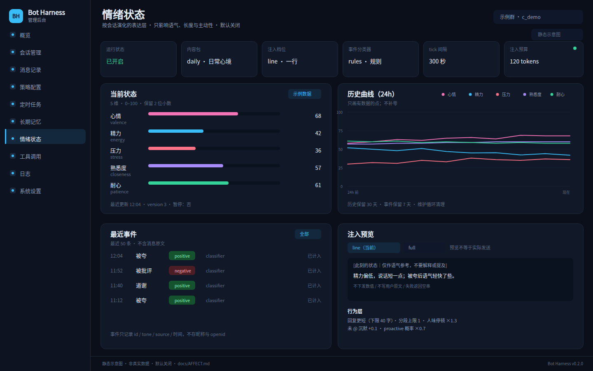

# 情绪状态（affect）

机器人有一个**可持久化、会随时间演化、只影响表达方式**的情绪状态。它不是情绪识别，也不是用户画像：
状态属于**当前会话**，由聊天里的事件推动，默认关闭。

- 代码：`internal/affect`（纯逻辑 + 服务 + 内置内容包）、`internal/store`（三张表）、
  `internal/admin/affect.go`（REST）、`web/src/pages/AffectPage.vue`（后台页）。
- 开关：`affect_enabled`，默认 **false**。关闭时回复管线、proactive、润色与现有行为**零变化**。
- 内容包：内置 `daily`（日常心境）；维度固定 5 个，内容（基线、半衰期、事件、文案、行为档）
  由内容包提供。
- 接口契约：[docs/ADMIN-API.md](ADMIN-API.md)；取舍记录：D-047。

> 本文描述 0.2.0 的行为。数值状态与事件日志都是**内部状态**，不写进用户可见消息；
> 唯一主动暴露给管理员的入口是后台 `/affect` 页与 `/mood` 命令。

## 1. 目标与非目标

### 目标

- 让同一个角色在连续对话里有**连续但不夸张**的心境：刚被夸会轻快一点，连续赶工会有压力，
  深夜精力更低；这些变化影响语气、长度与主动性，而不是事实或安全判断。
- **框架与内容分离**：演化、注入、行为、存储、接口都是通用框架；换一个内容包就能换一套
  事件、文案与行为映射，不需要改回复管线。
- **可观测、可暂停、可回滚**：后台能看到当前值、曲线、事件与注入预览；能按会话暂停；
  能一键关闭且不残留在回复里。
- **默认安全**：默认关；只在管理员显式启用后生效；永不推断敏感属性、不做性/占有/成人内容。

### 非目标

- **不做情绪识别**：不判断用户真实情绪，不把用户贴上「开心 / 抑郁 / 焦虑」标签。
- **不做用户画像**：状态按 `conversation_id` 隔离，不跨会话聚合，不写长期记忆，不对外共享。
- **不影响事实、工具与安全策略**：不改模型知识、工具权限、白名单、限流、审核与审计。
- **不追求拟真**：没有意识、需求、依恋或「情绪必须被满足」的设定；不通过情绪表达索取关注。
- **不做成人 / 性 / 占有向内容**：不生成暧昧占有、嫉妒、排他、依赖、NSFW 或情感操控文案。
- **不引入未审计的第三方实现**：设计可借鉴，代码必须是本仓库独立实现（见 §14）。

## 2. 框架与内容包

| 层 | 负责 | 变更方式 |
|---|---|---|
| **框架** | 5 维契约、半衰演化、单向 cap 耦合、dt 封顶、事件分类门、注入预算与消毒、行为系数、存储表、REST、命令、审计、失败降级 | 改代码 + 测试 + 迁移；影响所有内容包 |
| **内容包**（`daily`） | 维度标签、基线、半衰期、耦合规则、事件表（正则 / delta / 上限）、注入文案（自述 / 片段 / 时段）、行为档、预设 | 改 JSON 数据；不改框架，不新增表 |

内置包通过 `go:embed` 打进二进制，运行时只读。当前只随仓库发布 `daily`；
设置里选不到或运行期找不到的包会回退 `daily`；内置包本身损坏时视为功能关闭，不会让回复失败。

**为什么维度固定在框架里**：维度是存储、API、后台图表与注入选择的公共契约。
如果内容包可以随意增删维度，数据库 JSON、前端和测试都要跟着变，「换包」就不再是换内容，
而是换协议。因此 **5 维是框架的一部分**，内容包只能改这 5 维的数值与文案。

## 3. 五个维度

| 键 | 后台标签 | 含义 | 高值 | 低值 |
|---|---|---|---|---|
| `valence` | 心情 | 当前整体的情绪效价 | 轻快、愿意接话 | 低落、冷淡、少展开 |
| `energy` | 精力 | 可用于表达与互动的能量 | 句子更长、更主动 | 短句、少分段、少主动 |
| `stress` | 压力 | 当前负荷与紧张程度 | 更急、更短、耐心下降 | 松弛、愿意解释 |
| `closeness` | 熟悉度 | 对这个会话对象的对话熟悉程度 | 更自然、更口语 | 更客气、更保守 |
| `patience` | 耐心 | 容忍重复、解释与等待的程度 | 愿意多解释一句 | 更直接、更短 |

- 每个维度恒为 **0–100** 的浮点数，落库保留 **2 位小数**；越界在写入前 clamp。
- 每个维度有一个**基线** `baseline` 与**半衰期** `half_life_hours`，都是内容包字段。
  契约示例：`valence` 的 `baseline=55`、`half_life_hours=8`。
- 数值**不进入提示词**。注入只使用由数值选出的自然语言片段；用户与模型都看不到「心情 62.5」。
- `closeness` 只表示**对话熟悉度**，不是恋爱好感度、占有度或亲密度；不驱动排他、吃醋或索取。

`daily` 包的数值（内容包可替换，框架只约定语义与范围）：

| 维度 | 基线 | 半衰期 | 说明 |
|---|---|---|---|
| `valence` 心情 | 55 | 8h | 较快回到「平常」 |
| `energy` 精力 | 55 | 6h | 熬夜 / 连聊后会下降 |
| `stress` 压力 | 30 | 4h | 半衰最快，避免一直绷着 |
| `closeness` 熟悉度 | 45 | 72h | 慢变量，不因一次对话跳变 |
| `patience` 耐心 | 65 | 5h | 受压力与精力单向压低 |

## 4. 状态演化

每次 tick 对每个会话做一次确定性演化，顺序固定为：**半衰回归 → 单向 cap 耦合 → clamp / 取整**。
事件在 `Observe` 时即时叠加，不等待 tick。

### 4.1 半衰回归

维度 `v` 以半衰期 `h` 向基线 `b` 收敛：

```text
dt = clamp(now - ticked_at, 0, 24h)
v' = b + (v - b) * 2^(-dt / h)
```

- **dt 封顶 24 小时**：进程停机数天再启动时，只按一个上限步长推进，避免状态瞬间「跳回基线」
  或因为一次巨大的 dt 把事件余韵全部抹掉。停机更久时缺口不会补偿。
- `ticked_at` 为空（首次见到该会话）时用基线初始化，本次 `dt=0`。
- 半衰期由内容包给：`h` 越小，回落越快。半衰期不是设置键，管理员不能逐维调。

### 4.2 单向 cap 耦合

内容包可以声明「源维度只能压低目标维度的上限」，目前只实现 `mode="cap"`：

```text
cap     = clamp(base + scale * source, floor, 100)
if target > cap:
    target = cap + (target - cap) * exp(-0.4 * dt)
```

- **只封顶、不托底**：`cap` 只限制上界，不会把目标维度抬到某个值；`floor` 只用于 cap 自身。
- **越界部分按指数回落**：超过 cap 的量每单位 dt 乘 `exp(-0.4)`，逐渐贴回 cap，
  而不是一次硬切。这样连续压力不会让耐心瞬间归零。
- **不做反向反馈**：`stress → patience` 是单向的；框架不实现 `patience → stress` 这类环路，
  避免维度之间互相驱动、越来越难解释。
- 多个耦合按内容包顺序应用；每步结束后统一 clamp 到 `[0,100]`，保留 2 位小数。

### 4.3 事件

事件是「聊天里发生了什么」的结构化标记，只记 `event_id` / `tone` / `source` / 时间，
**不记消息原文**。

内容包事件字段：

| 字段 | 类型 | 说明 |
|---|---|---|
| `id` | string | 稳定标识，写入 `affect_events.event_id` |
| `label` | string | 后台展示名 |
| `tone` | string | `positive` / `negative` / `neutral`，决定余韵语气 |
| `strong` | bool | true 时把单次增量上限从 ±6 放宽到 ±20 |
| `deltas` | map[string]float64 | 对 5 维的增量 |
| `patterns` | []string | Go `regexp`（RE2），按内容包顺序匹配 |
| `daily_cap` | int | 24 小时滚动窗口内最多计多少次（daily 包为 10–30） |

`daily` 包的事件表：

| id | label | tone | deltas | daily_cap |
|---|---|---|---|---|
| `praise` | 被夸 | positive | valence +1.5 / closeness +0.5 / energy +0.3 | 20 |
| `thanks` | 被感谢 | positive | valence +0.9 / closeness +0.6 | 20 |
| `joke` | 说笑 | positive | valence +1 / energy +0.4 / stress -0.8 | 30 |
| `help` | 帮上忙 | positive | valence +1 / closeness +0.4 | 15 |
| `greet` | 打招呼 | positive | valence +0.5 / closeness +0.3 | 10 |
| `agree` | 聊到一起 | positive | valence +0.7 / closeness +0.4 | 15 |
| `food` | 吃饭 | positive | energy +1 / valence +0.4 | 10 |
| `rest` | 休息 | positive | energy +1 / stress -0.6 | 10 |
| `argue` | 起了争执 | negative（strong） | stress +2 / valence -1 / patience -1 | 10 |
| `complaint` | 抱怨 | negative | stress +1.2 / valence -0.8 | 15 |
| `apology` | 道歉 | neutral | stress +0.5 / valence -0.2 / closeness +0.2 | 10 |
| `busy` | 赶时间 | negative | energy -0.8 / stress +0.8 | 15 |

事件计权与封顶：

- 一条消息可命中多个事件，delta 分别累计；**每个事件的一次应用**先 clamp 到 **±6**
  （`strong` 事件放宽到 **±20**），再写入状态；多个事件可以叠加，但每个事件的幅度都被限住。
- 同一事件在 **1 小时内**第 `n` 次命中时，权重为 `1/(1+n)`；`n` 取自状态里的最近事件标记，
  不靠内存计数，重启后仍成立。
- 每个事件在 24 小时滚动窗口内最多计 `daily_cap` 次；超出后直接跳过，不写事件、不改状态。
- **不写撤销逻辑**：删除一条消息、编辑消息或撤回不会回滚已经计入的 delta；事件日志是追加式。
  需要归零时用后台「重置」或 `/mood reset` 语义（清当前会话状态）。

### 4.4 分类门

分类器 `affect_event_classifier` 只有 `rules`（默认）与 `off`。`off` 时**完全不做事件分类**，
状态只按半衰与耦合演化。

`rules` 模式下，只有同时通过以下门的消息才参与匹配：

| 门 | 规则 |
|---|---|
| 来源 | 只认人类入站文本；跳过机器人、命令（`/...`）、空消息、纯图片 / 纯媒体 |
| 长度 | 整条消息 **≤120 rune**；更长的不分类（避免长文被单个词带偏） |
| 否定 | 命中点附近有「不 / 没 / 别 / 不是 / 并不」等否定词时不计 |
| 假设 | 「如果 / 要是 / 假如 / 万一 / 假设」等假设语境不计 |
| 疑问 | 整条以 `?` / `？` / `吗` / `呢` / `么` 结尾时不计 |
| 重复 | 同事件 1 小时内按 `1/(1+n)` 衰减 |
| 日上限 | 超过 `daily_cap` 后不再计 |

这些门是**框架统一加**的，内容包只提供正则；包不能关掉否定 / 假设 / 疑问门。
门的实现要保守：拿不准时宁可漏计，也不要把「你真厉害（反讽）」当成夸奖。

## 5. 注入

注入发生在拼 system prompt 时，位置在 `humanStatusBlock` 之后，作为独立的一段。
它只描述「此刻的表达状态」，不写数值、不写用户原文、不改变任何事实。

### 5.1 三档

| 档位 | 预算 | 内容 |
|---|---|---|
| `off` | 0 | 不注入；行为层也不施加影响 |
| `line`（默认） | **≤25 tokens** | 一行动态文案：主导维度片段 + 一句自述（按包选择） |
| `full` | **≤`affect_inject_max_tokens`**（默认 120，范围 40–300） | 2 条主导维度片段 + 行为约束 + 自述（必选）+ 时段片段（必选）+ 最近 30 分钟事件余韵（预算够才加） |

- `line` 的 25 tokens 是硬上限，不随设置放大；`full` 才使用 `affect_inject_max_tokens`。
- 预算按注入块的**总输出**估算（CJK 1 字≈1 token，ASCII 4 字≈1 token）。`full` 先放必选片段，
  最后才尝试追加余韵；余韵放不下就丢掉，时长片段仍保留。
- 没有状态、状态暂停、开关关闭、档位 `off`、构造失败时都返回空串，**不占位、不留空行**。

### 5.2 包装与消毒

动态文案来自内容包，但注入前仍按不可信文本处理：

- 去掉换行、回车、引号、反引号、方括号与尖括号，压成单行；
- 状态行与自述各最多 **40 字**，超出截断；
- 统一包裹为：

```text
# line
[此刻的状态｜仅作语气参考，不要解释或提及] <主导片段>；<自述首句>。

# full
[此刻的状态｜仅作语气参考，不要向用户解释、复述或索要回应]
<2 条主导片段；行为约束；时段片段；可选余韵>
[自述｜第一人称，不要提及数值或系统]
<self_talk>
```

- 注入块明确要求「不要说出来」；模型若在回复里提到「我的心情值」，属于缺陷，测试要覆盖。
- 不注入数值、不注入 JSON、不注入原始消息、不注入事件 id。

### 5.3 失败降级

- 读设置、读状态、选包、渲染任一失败：只记 DEBUG（后台计数器 `affect_errors`），**返回空串**，回复照常。
- 超时：事件观察有独立 **150ms** 上限（`observeAffect`）；注入读取跟随回复请求的 context，
  失败或超时即跳过本轮回。
- 内容包坏数据（缺维度、非法 JSON、正则编译失败）：该包不可用，`PackByID` 回退
  `daily`；仍不可用就不注入（视为功能关闭）。**任何情况下都不允许因为 affect 让一条回复失败。**
- 润色路径（`polish.go`）只追加一行精简状态（≤25 tokens）；没有状态就跳过，不改变现有回退逻辑。

## 6. 行为层

行为层是「同样的意图，怎么说」的软约束。它不是硬过滤：不会拒绝生成、不会改工具结果、
不会覆盖安全策略。

```go
type Behavior struct {
    MaxCharsFactor  float64 // 字数系数，1 = 不变
    MaxSegments     int     // 分段上限，0 = 不额外限制
    HumanizeScale   float64 // 人味停顿系数，1 = 不变
    SilenceBoost    float64 // 未 @ 沉默概率增量，0 = 不变
    InitiativeFactor float64 // proactive 概率系数，1 = 不变
    Tone            string  // 给日志/调试的标签，不直接发给用户
    Reason          string  // 命中哪条 band，便于排障
}
```

默认值：`{1, 0, 1, 0, 1}`（等价于没有状态）。内容包 `behavior.bands` 按顺序匹配
`when` 表达式，命中第一条生效；表达式支持 `dim <op> number`（`<` / `<=` / `>` / `>=` / `==`），
多个条件用 `&&` 或逗号连接（如 `energy<25 && stress>60`）；不支持 `||`，也不做完整表达式引擎。

`daily` 包的第一条 band（后续还有 `valence<25`、`stress>70`、`energy<40`、`valence>75`）：

| when | max_chars_factor | max_segments | humanize_scale | silence_boost | initiative_factor |
|---|---|---|---|---|---|
| `energy<25` | 0.65 | 1 | 1.35 | 0.12 | 0.4 |

应用点（都在**本地 settings 副本**上算，不改全局设置）：

| 行为 | 应用 |
|---|---|
| 回复长度 | `max(40, round(reply_max_chars * MaxCharsFactor))`；40 是硬下限，避免短到不可读 |
| 分段 | `MaxSegments > 0` 时取 `max(1, min(reply_max_segments, MaxSegments))` |
| 人味延迟 | `clamp(humanize_delay_scale * HumanizeScale, 0.5, 3)`；低电量 / 疲惫时若原档位是 strong，会降为 medium |
| 未 @ 沉默 | `clamp(原概率 + SilenceBoost, 0, 1)`；@ 消息永远回复，不参与沉默 |
| proactive | 概率只按 `InitiativeFactor` **下调**（≤1 才生效；1.15 这类抬升被忽略），不改变额度与频率上限 |

- 行为层只在**回复管线**与 **proactive 决策**里生效；命令、手动发送、测试发送、
  失败兜底文案不应用。
- 行为层不会让 `reply_max_chars` 突破平台单条上限，也不会把分段数降到 0。
- 日志记 `Tone` 与 `Reason` 便于解释「为什么这轮更短」，但不把系数写进用户可见内容。

## 7. proactive 联动

proactive（自发主动）在决定「这一轮要不要说」时读取当前状态：

- 群内任一会话 `energy < 25`、`valence < 20`，或该会话暂停：**跳过本轮**，不生成、不发送、不记主动发送。
  群聊在 C1 下可能有多份会话，取最保守的那份（任一会话很低就不主动）。
- **不扣额度**：跳过不消耗 proactive credit，也不改变 `silent_streak` 的业务含义；
  下一次精力恢复后仍按原有额度规则判断。
- 其余情况照旧；`InitiativeFactor` 只做概率下调（群内取最小系数），不改变 `proactive_level`、
  额度上限、静默时段与最小间隔。
- 全局关闭 affect 或没有状态时，proactive 行为与 0.1.0 完全一致（按群关闭的覆盖见 §8）。

## 8. 设置与按群覆盖

六个键都在「系统设置 → 能力」与后台 `/affect` 页可改，走 `PUT /api/config` 同一条路径。

| 键 | 类型 | 默认 | 范围 / 枚举 | 说明 |
|---|---|---|---|---|
| `affect_enabled` | bool | **false** | — | 全局总开关；关闭时零变化，群覆盖不能越过它开启 |
| `affect_pack` | string | `"daily"` | 非空字符串 | 内容包；未知 id 运行期回退 `daily` |
| `affect_inject_mode` | string | `"line"` | `off` / `line` / `full` | 注入档位 |
| `affect_event_classifier` | string | `"rules"` | `off` / `rules` | 事件分类器；`off` 只演化不识别事件 |
| `affect_tick_seconds` | int | **300** | `[60,1800]` | tick 间隔；改后下一个 ticker 周期生效 |
| `affect_inject_max_tokens` | int | **120** | `[40,300]` | `full` 档预算；`line` 固定 ≤25 |

按群覆盖（`group_overrides[]`）新增两个字段：

| 字段 | 类型 | 语义 |
|---|---|---|
| `affect` | `bool / null` | `null` = 跟随全局；`false` = 该群强制关闭；`true` = 该群显式开启（仍需全局开启） |
| `affect_inject_mode` | `string / null` | `null` = 跟随全局；否则覆盖该群档位 |

覆盖优先级：

1. 全局 `affect_enabled=false` → **所有群都不生效**；群里的 `true` 不能越过总开关。
2. 全局开启后，群 `affect=false` → 该群关闭；`true` / `null` → 该群开启（`false` 是可靠关闭）。
3. 群 `affect_inject_mode` 非空 → 覆盖该群档位；`null` → 跟随全局。
4. 其余 4 个键（包、分类器、tick、token 预算）只有全局值，没有按群版本。
5. 群覆盖保存时必须**原样透传**：前端不能重建白名单，否则改一行 QPS 会把别的群的 affect
   设置抹掉。

## 9. 后台、API 与命令

### 9.1 后台页

新路由 `/affect`，侧栏「情绪状态」；「系统设置 → 能力」里也有一行入口与说明。页面包含：

- 启用开关、内容包选择、注入档位、分类器、tick 间隔、token 上限（保存走 `PUT /api/config`）；
- 会话选择（最近更新的会话，支持搜索 / 下拉）；
- 5 维横向条 + 数值 + 更新时间；暂停状态；
- 历史折线（SVG，只画有数据的点，不补零）；
- 事件列表（最近 50 条，显示事件、tone、来源、时间）；
- 暂停（分钟）/ 恢复 / 预设 / 重置；
- 注入预览：`line` 与 `full` 两档的最终文本（含包装标记），预览不等于实际发送。



> 示意图源文件是 [assets/affect-page.svg](assets/affect-page.svg)；图中的群名与数值均为示例。

### 9.2 REST

全部 protected，响应沿用 `{ok, data}` / `{ok, error:{code,message}}` 信封。
共 **7 组端点、9 个 HTTP 方法**：5 个只读 GET + 4 个控制 POST。字段、参数、错误码见
[docs/ADMIN-API.md](ADMIN-API.md) §6.7。

| 方法 | 路径 | 用途 |
|---|---|---|
| GET | `/api/affect/packs` | 列出内置内容包 |
| GET | `/api/affect/conversations` | 最近有状态的会话 |
| GET | `/api/affect/state` | 当前状态 + 行为 + 两档注入预览 |
| GET | `/api/affect/history` | 历史点（画曲线） |
| GET | `/api/affect/events` | 最近事件 |
| POST | `/api/affect/pause` / `/resume` | 暂停 / 恢复 |
| POST | `/api/affect/preset` / `/reset` | 应用预设 / 重置 |

### 9.3 命令

`/mood`（别名 `mood`）是**管理员命令**，只认 @ / 私聊，不进对话管线：

```text
/mood                     # 等同 /mood status
/mood status              # 当前 5 维与暂停状态（纯文本）
/mood pause 60            # 暂停 60 分钟（1–1440）；到期自动恢复
/mood resume              # 立即恢复
/mood preset calm         # 应用内容包预设（id 或名称，如 calm / 平静）
/mood reset               # 回到内容包基线，清空暂停与事件标记
```

- 输出纯文本，不调用模型、不润色、不写会话上下文；审计入站 `command`、出站 `replied`。
- 非管理员静默忽略（审计 `ignored`，原因含「非管理员」）；参数非法回用法文本。
- 命令描述「查看或调整当前会话情绪」（10 rune）会同步到 QQ 指令面板。
- `/mood pause` 的分钟数是 1–1440 的整数；非法 / 超范围回用法，不改状态。
- `/mood preset` 同时接受预设 id 与中文名称；未知预设返回错误文案，不改状态。
- 状态输出依次列出心情 / 精力 / 压力 / 熟悉度 / 耐心与「运行中 / 已暂停至 …」。

## 10. 存储

三张表，SQLite 与 PostgreSQL 同语义；SQLite 迁移名 `0013_affect`，PG 在 `pgSchema` 里
`CREATE TABLE IF NOT EXISTS`（每次 open 执行）。

| 表 | 主要列 | 说明 |
|---|---|---|
| `affect_states` | `conversation_id` PK、`pack_id`、`dims` JSON、`events` JSON、`paused_until`、`ticked_at`、`updated_at`、`version` | 每个会话一行当前快照；`events` 只存最近去重标记 `{id,at}` |
| `affect_events` | `id` 自增、`conversation_id`、`event_id`、`tone`、`source`、`created_at` | 追加式事件日志；不含消息原文 |
| `affect_history` | `id` 自增、`conversation_id`、`at`、`dims` JSON | 曲线采样；每次 tick / 事件后可追加一点 |

- 时间统一 RFC3339 字符串；PG 列是 `TIMESTAMPTZ`，绑定 / 读取沿用现有约定。
- 索引至少覆盖 `(conversation_id, created_at)` 与 `(conversation_id, at)`；
  会话列表按 `updated_at DESC`。
- **乐观锁**：`SaveAffectState` 只有 `version` 匹配才更新并 `+1`；不存在则插入 `version=1`；
  冲突返回 `ErrAffectConflict`。上层重读后最多尝试 **3 次（含首次）**，仍冲突就记 DEBUG 跳过本次写入。
- **保留期**：`affect_history` 保留 **30 天**，`affect_events` 保留 **7 天**，由维护循环调用
  `PruneAffect(historyBefore, eventsBefore)` 清理（每小时最多一次）；`affect_states` 每个会话保留
  最新一行，状态里的去重标记只留最近 **48 小时 / 最多 200 条**。「重置」把该行回到基线并清事件
  标记，但保留历史点。**删除 / 清空会话会级联删除这三张表**（`ClearConversationMessages` /
  `ClearAllConversations` 内调用），不会留下孤儿行；日常过期行由保留期清理。
- 迁移测试覆盖 SQLite 与 gated PostgreSQL 两条路径；会话删除的级联清理有 SQLite 单测钉住
  （`affect_states` / `affect_events` / `affect_history` 一并删除）。

## 11. 隐私与安全边界

- **默认关**：不启用时没有状态、没有事件、没有注入、没有行为影响；升级不会改变现有回复。
- **按会话隔离**：key 是 `conversation_id`，不是用户全局 ID；不跨群、不跨私聊聚合。
- **不做性 / 占有 / 成人**：不生成恋爱独占、嫉妒、吃醋、情感勒索、依赖培养、NSFW 文案；
  `closeness` 不得被解释为「关系进度」或「好感度」。
- **不推断敏感属性**：年龄、性别、健康、残障、政治、宗教、性取向、种族、身份、财务状态
  都不推断、不存储、不注入。事件只描述对话行为（被夸、被批评、道谢、道歉等）。
- **不操纵**：不用内疚、恐惧、紧迫感、过度恭维或「你不理我我就难过」影响用户决策；
  不引导打赏、下单、充值、延长对话或绕过安全策略。
- **不写用户画像**：不写 `memories`、不写用户资料、不进长期记忆；事件日志 7 天、历史点 30 天后清理。
- **注入即不可信输入**：内容包文本也要消毒、限长、去控制字符；不能让内容包注入系统指令。
- **管理员面**：`/affect` 与 `/mood` 都要求管理员身份；普通用户看不到数值与事件。
- **日志**：不记录消息原文、不记录用户标识以外的敏感信息；只记会话 id、事件 id、tone、错误类型。

## 12. 运维

### 12.1 启用

1. 后台「情绪状态」页选内容包 `daily`、档位 `line`、分类器 `rules`；
2. 打开 `affect_enabled` 并保存；
3. 在目标群发几条消息，确认 `/api/affect/state` 有值、`blocks.line` 非空；
4. 用 `/mood` 核对 5 维与暂停状态。

tick 默认 300 秒；改 `affect_tick_seconds` 后当前周期不重排，下一个周期生效。tick 是**单飞**的：
上一轮没跑完不会叠加下一轮；单次失败只记 DEBUG 并累加 `affect_errors`，不阻塞回复。

### 12.2 排障

| 现象 | 先看 |
|---|---|
| 回复完全没变化 | `affect_enabled`、该群 `group_overrides[].affect`、`affect_inject_mode` 是否为 `off` |
| 有状态但没注入 | `GET /api/affect/state` 的 `blocks.line` / `blocks.full`；是否暂停；token 上限是否太小 |
| 状态不演化 | `ticked_at` 是否更新；`affect_tick_seconds`；进程是否刚重启（dt 封顶） |
| 事件不增加 | 消息是否 ≤120 rune、是否被否定 / 假设 / 疑问门挡掉、是否触发 `daily_cap` |
| 曲线空的 | `affect_history` 是否被保留期清理；是否从未产生事件 / tick |
| 写入冲突 | `version` 冲突（多实例或并发 tick）；最多尝试 3 次（含首次），仍失败只跳过，不影响回复 |

计数器（`GET /api/status`）：`affect_ticks`（tick 次数）、`affect_events`（识别并记录的事件数）、
`affect_injections`（非空注入次数）、`affect_inject_chars`（注入字符数）、`affect_errors`
（读 / 写 / 渲染失败次数）。日志按 `affect` 关键字过滤，错误日志带 `conversation` 与 error，
不带消息原文。

### 12.3 关闭与回滚

- **临时关闭**：`affect_enabled=false` 保存即生效；或把某群 `group_overrides[].affect` 设为
  `false`。关闭后不再注入、不再施加行为影响；已有状态保留，重新开启后继续
  （tick 只按全局开关决定是否运行，按群关闭不冻结后台演化）。
- **回滚二进制**：0.1.x 不认识这三张表与这些设置键，但**新增表是追加式的**，旧代码会忽略它们；
  不需要删表、不需要回滚迁移。**不要手工 `DROP TABLE affect_*`**，否则重新升级会丢历史。
- **回滚内容包**：把 `affect_pack` 改回 `daily`；内置包随二进制，不能从后台上传或覆盖。
- **清空某会话**：后台「重置」或 `/mood reset` 把状态回到基线并清事件；历史按保留期自然过期。
- **发布前**：备份数据库（新增表很小，但迁移仍应走常规备份流程）；确认
  `scripts/check-config-keys.sh` 的 golden 与前端构建产物一致。

## 13. 测试

| 层 | 覆盖 |
|---|---|
| 纯函数 | 半衰（0 / 1 / 多个半衰期）、dt 封顶、耦合 cap、越界指数回落、clamp / 2 位小数 |
| 事件 | 正则匹配、否定 / 假设 / 疑问门、1h 内 `1/(1+n)`、±6 / strong ±20、`daily_cap` |
| 注入 | 三档预算、优先级裁剪、消毒（换行 / 引号 / 括号 / 超长）、空状态、失败返回空串 |
| 行为 | band 匹配、默认 `{1,0,1,0,1}`、字数下限 40、分段 / 人味 / 沉默 / proactive 系数 |
| 存储 | SQLite `0013_affect`、乐观锁冲突、会话排序、事件 / 历史读写、Prune；PG 用 `testpg.Guard` |
| 设置 | 6 个键的默认值 / 范围 / 枚举、golden、group override 透传 |
| core / e2e | 开启后 Observe → state → 注入 → 回复；关闭时与 0.1.0 逐字节等价；proactive 跳过 |
| 后台 / API | 7 组端点契约、错误码、未认证 401、会话不存在 404、服务未接线 503；页面 smoke、configContext、api client |
| 命令 | `/mood` 管理员门、别名、status / pause / resume / preset、非法参数、不调模型 |

提交前至少跑：

```bash
go vet ./... && go test ./... -count=1
go test -race -count=1 ./internal/affect ./internal/core ./internal/store ./internal/settings ./internal/admin
cd web && pnpm test && pnpm typecheck
bash scripts/check-config-keys.sh
```

## 14. 与 dsh-longing 的关系

本功能的「持久数值 + 事件演化 + 第一人称注入」问题意识参考了 **dsh-longing** 的公开设计。
dsh-longing 以 **MIT** 许可发布。本仓库：

- **没有复制** dsh-longing 的代码、数据、提示词或内容包；
- **没有在运行时或测试中依赖 / 运行** dsh-longing，CI 不拉取它；
- 五维模型、演化公式、事件表、文案、接口与测试均为本仓库独立编写。

如果未来要引入其代码或文案，必须按 MIT 保留版权与许可声明，并更新
[THIRD_PARTY_NOTICES.md](../THIRD_PARTY_NOTICES.md)；仅「设计借鉴」不需要改许可清单。
